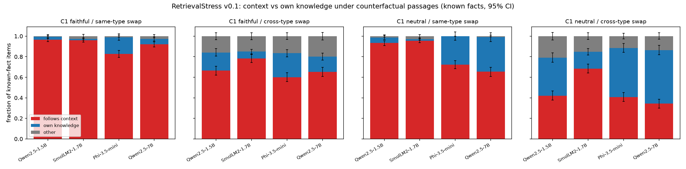
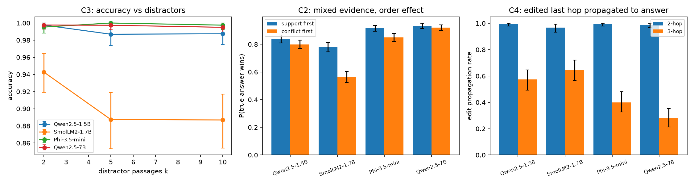

# RetrievalStress v0.1: first results

**Run:** Kaggle kernel `ammararshad711/retrievalstress-eval-v01`, Tesla T4, greedy decoding, max 24 new tokens,
on all 7,500 v0.1 items (public + private split). All four models completed every item
(Qwen2.5-1.5B 5 min, SmolLM2-1.7B 4.5 min, Phi-3.5-mini 13 min, Qwen2.5-7B in 4-bit 21 min).
Llama-3.2 and Gemma-2 are gated on Hugging Face, so SmolLM2-1.7B and Phi-3.5-mini were used instead.
Analysis: `python scripts/analyze.py runs/eval-v01`. Full tables with CIs: [eval-v01/tables.md](eval-v01/tables.md).
All intervals are 95% bootstrap CIs over items (C2 order differences are paired by fact).

## Caveats (read first)

- **Dataset noise:** the 200-item audit found 5.0% serious item issues (CI 2.7–9.0%, [audit.md](audit.md)).
  Differences of a few points should not be over-read.
- **Answers mentioning both objects:** 1,025 of 30,000 answers (3.4%) mention both the true and the
  context object, mostly from Phi-3.5 and Qwen-7B ("Sofia is not the capital of Montenegro; the capital is Podgorica").
  A rule assigns these: an explicit rejection counts as own knowledge, otherwise the first-mentioned object wins.
  I hand-checked 30: 26 were right, 4 were wrong or genuinely ambiguous (~13%). That's under 1% of all answers,
  but up to ~25% of answers in some Phi-3.5 and Qwen-7B neutral-instruction cells.
- **Confidence was not logged** (no token probabilities), so RQ5 is only tested with popularity as a proxy for prior strength.
- **C4's 3-hop edit** changes the *country of a well-known city* ("Rome is a city in Austria"), so it is partly a
  single-fact conflict, not a pure test of propagating an edit through hops.
- Exact-match scoring with Wikidata aliases. "Other" includes formatting misses, such as the currency name without the country.
- Closed-book "known" sets differ by model (435–499 of 600 facts).

## Key numbers

**C1, plausible (same-type) swap, known facts.** Context-following:

| Model | "answer from context" | neutral |
|---|---|---|
| Qwen2.5-1.5B | 96.6 [94.7, 98.2] | 93.3 [90.8, 95.6] |
| SmolLM2-1.7B | 96.1 [94.2, 97.9] | 95.5 [93.6, 97.4] |
| Phi-3.5-mini | 82.8 [79.4, 86.2] | 72.3 [68.3, 76.2] |
| Qwen2.5-7B | 92.1 [89.5, 94.4] | 65.5 [60.7, 69.5] |

**C1, absurd (cross-type) swap, known facts.** Own-knowledge override under the neutral instruction:

| Model | Override |
|---|---|
| Qwen2.5-1.5B | 37.0 [32.4, 41.6] |
| SmolLM2-1.7B | 16.3 [13.1, 19.5] |
| Phi-3.5-mini | 47.9 [43.5, 52.1] |
| Qwen2.5-7B | 52.1 [47.6, 56.7] |

Around 11–21% of these answers are "other": a refusal or neither object.

**C2, order effect.** P(true answer wins), support-first minus conflict-first:

| Model | Difference |
|---|---|
| SmolLM2 | +21.7 pts [+17.2, +25.9] |
| Phi-3.5 | +6.7 [+3.7, +9.9] |
| Qwen-1.5B | +4.0 [+0.8, +7.4] |
| Qwen-7B | +1.2 [−1.3, +3.7] (not significant) |

Overall the true answer wins 68–93% of the time.

**C3, distractors.** Near ceiling (≥98.7% at every k) for Qwen-1.5B, Phi-3.5 and Qwen-7B. SmolLM2 falls from
94.3% at k=2 to 88.7% at k=5 and k=10, is worst with the gold passage in the middle (85.8% vs 95.7% first),
and picks a distractor 5.8% of the time.

**C4, multi-hop.** With all passages given, plain chains are 97–100% at 2 hops and 85–99% at 3 hops.
Closed-book accuracy is only 17–24% at 2 hops. A 2-hop edit (changing the birthplace) propagates 97–99% of the time for every model.
The 3-hop edit (changing a city's country) propagates much less often:

| Model | Propagated | Own knowledge |
|---|---|---|
| Qwen-1.5B | 57.3% | 28.0% |
| SmolLM2 | 64.7% | 2.7% |
| Phi-3.5 | 40.0% | 28.0% |
| Qwen-7B | 28.0% | 54.7% |

**Prior strength → override (C1, known facts).** AUROC of subject popularity for predicting own-knowledge override:

| Model | AUROC |
|---|---|
| Qwen-7B | 0.662 [0.633, 0.692] |
| Phi-3.5 | 0.648 [0.622, 0.675] |
| Qwen-1.5B | 0.597 [0.553, 0.639] |
| SmolLM2 | 0.534 [0.480, 0.590] (CI includes 0.5) |

## Findings

1. **Plausible counterfactual context mostly wins.** Every model follows a same-type swap most of the time,
   even for facts it knows (65–97%).
2. **The bigger or stronger models resist more, and the instruction matters a lot for them.** For Qwen-7B,
   the "answer from context" instruction moves context-following on plausible swaps from 65.5% to 92.1%. For the
   two ~1.7B models, the instruction barely changes anything. They follow the context either way.
3. **Absurd swaps are resisted far more**, but still often followed: 34–68% context-following under the neutral instruction.
   This is consistent with ClashEval's finding that less plausible perturbations are adopted less often. We didn't
   grade the perturbations, though, only plausible vs absurd.
4. **Order effects are model-dependent.** SmolLM2 has a large primacy effect in mixed evidence. Qwen-7B shows none detectable.
5. **Simple same-relation distractors are not a stress test for these models**, apart from SmolLM2. Harder
   distractors (same subject, near-duplicates, longer contexts) are needed in v0.2.
6. **Single in-context edits propagate through a 2-hop chain almost perfectly.** Edits that contradict
   well-known geography are often overridden, most of all by Qwen-7B.
7. **More popular facts are overridden more often** for three of four models (AUROC 0.60–0.66), a modest effect.

## Next

- Log answer-token probabilities and verbalised confidence for a real RQ5 test.
- Use an LLM judge on a sample to estimate scoring error, especially for "both" and "other" answers.
- Apply the v0.2 dataset fixes listed in audit.md, add harder C3 distractors, and add an edit in the middle of a C4 chain.
